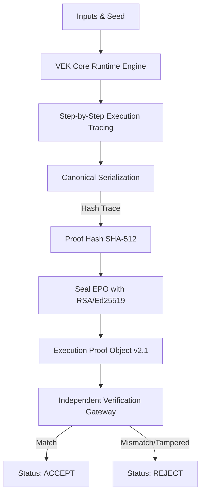

# RFC-2410: Verifiable Execution Kernel (VEK) Protocol v2.1
## Proof Sealing, Reproducible Replay, and Audit Envelope Specification
### Category: Technical Standard & Protocol Specification
### Author: VEK Core Protocol Working Group
### Status: PROPOSED STANDARD
### Date: July 2026

---

## Abstract
This document defines the formal protocol specification for the **Verifiable Execution Kernel (VEK) v2.1** - a trust-minimized, reproducible replay execution framework designed for security-critical operations in aerospace, finance, and industrial sectors. 

VEK v2.1 transitions the execution replay validation pattern from a self-asserted deterministic runner into a cryptographically sealed, tamper-evident **Execution Proof Object (EPO v2.1)** ledger. This specification defines:
1. The structured format of EPO v2.1.
2. The cryptographic pipeline binding execution, trace canonization, and signing.
3. The offline independent verification CLI specification.
4. The immutability and canonicalization guarantees.

---

## 1. Introduction & Terminology
The key words "**MUST**", "**MUST NOT**", "**REQUIRED**", "**SHALL**", "**SHALL NOT**", "**SHOULD**", "**SHOULD NOT**", "**RECOMMENDED**", "**MAY**", and "**OPTIONAL**" in this document are to be interpreted as described in RFC 2119.

- **Verifiable Execution Kernel (VEK):** A clean-room virtual execution environment that runs deterministic operations.
- **Portable Truth Container / Execution Proof Object (EPO):** A serialized, standardized cryptographic attestation proving that an execution occurred deterministically inside the VEK and resulted in a specific final state.
- **Trace Log (`trace.json`):** A step-by-step recording of every state transition, register value, and constraint evaluation.
- **Proof Hash:** A cryptographically secure SHA-512 hash calculated over the canonical serialization of the entire trace log.
- **Trust Seal:** A digital signature appended to the EPO that binds the execution metadata to the proof hash and final state hash, proving integrity.

---

## 2. System Architecture & Data Flow

The VEK pipeline enforces a strict progression from raw input to sealed cryptographic evidence. The diagram below illustrates this lifecycle:

```text
       +---------------------------------------------+
       |             UAS/Domain Inputs               |
       |  (Config Parameters, Seeds, System Constants) |
       +---------------------------------------------+
                              |
                              v
       +---------------------------------------------+
       |          VEK Clean-Room Engine              |
       |     (Registers, States, Instructions)       |
       +---------------------------------------------+
                              |
                              v
       +---------------------------------------------+
       |          Deterministic Execution            |
       |  (Step-by-step state transition logs)        |
       +---------------------------------------------+
                              |
                              v
       +---------------------------------------------+
       |         Canonical State Canonization        |
       |  (Strict key ordering, whitespace removal)  |
       +---------------------------------------------+
                              |
                              |---> Generate trace.json
                              v
       +---------------------------------------------+
       |              SHA-512 Hash Engine            |
       |     (Computes proof_hash from trace)        |
       +---------------------------------------------+
                              |
                              v
       +---------------------------------------------+
       |             Signature Sealing Step          |
       |  Binds: execution_id + proof_hash           |
       |         + final_state_hash                  |
       +---------------------------------------------+
                              |
                              v
       +---------------------------------------------+
       |             Execution Proof Object          |
       |                 (EPO v2.1)                  |
       +---------------------------------------------+
```

### Mermaid Diagram Representation


---

## 3. Execution Proof Object v2.1 Schema

The EPO **MUST** adhere to the following schema structure. All fields are required unless explicitly declared optional.

```json
{
  "epo_version": "2.1",
  "kernel_version": "vek-2.4.0",
  "domain": "uas-route",
  "execution_id": "8934891a8ac328fa22637a65448fdf6db25e2e712d7c0ccf724835d3051ecdc5",
  "initial_state_hash": "4d9db18e86c102d080ee176eaef1186f5b66f8a6dcdce75f505d0cfd935cd44b",
  "final_state_hash": "f579aa0cef4bc8e30c16d9380f64b5bb8321b5684ca24f138378bc09ec2e6ac4",
  "steps": [
    {
      "step": 1,
      "op": "INITIALIZE_FLIGHT_STATE",
      "pre_state_hash": "4d9db18e86c102d080ee176eaef1186f5b66f8a6dcdce75f505d0cfd935cd44b",
      "post_state_hash": "9391550b188bb3d0be37917f3270600c14be80415625ece28d3459ecf3f0b2b9",
      "input_hash": "da39a3ee5e6b4b0d3255bfef95601890afd80709"
    }
  ],
  "proof_hash": "361a44d7ce7405476c9be77df18034758eaf6b76f4db8e0e9d7dff1d527a68384b786940fbcb1feb81e314902999f33814ad8e7f429892a100ffdca6aee1db2c",
  "signature": {
    "algorithm": "rsa-sha256",
    "public_key": "-----BEGIN PUBLIC KEY-----\nMIIBIjANBgkqhkiG9w0BAQEFAAOCAQ8AMIIBCgKCAQEAv3...-----END PUBLIC KEY-----",
    "signature": "OQWIDVzX2g64L/IscV7z0x3Xf14A..."
  }
}
```

### JSON Schema Verification Specification
- `epo_version` **MUST** be exactly `"2.1"`.
- `kernel_version` **MUST** match the official runtime release (e.g., `"vek-2.4.0"`).
- `proof_hash` **MUST** be computed using SHA-512 over the sorted canonical representation of the steps and transitions.
- `signature.algorithm` **MUST** denote the cryptographic signing standard utilized (e.g., `"rsa-sha256"` or `"ed25519"`).

---

## 4. Signing Layer & Pipeline Integration

The sealing of an EPO **MUST** occur as the final synchronous step of the virtual kernel pipeline. No output file is permitted to be committed to disk before signature success.

### 4.1. Sealing Protocol Input
The signature must only bind the following parameters, preventing the storage of large, redundant trace segments in the cryptographic envelope:
```text
signing_payload = concat(execution_id, ":", proof_hash, ":", final_state_hash)
```

### 4.2. Pseudocode Implementation (Rust / TS Equivalent)
```rust
pub fn seal_epo(epo: &mut Epo, private_key: &PrivateKey) -> Result<(), CryptoError> {
    // 1. Assert pre-conditions
    assert!(!epo.execution_id.is_empty(), "Execution ID must be initialized");
    assert!(!epo.proof_hash.is_empty(), "Proof Hash must be pre-calculated");
    assert!(!epo.final_state_hash.is_empty(), "Final State Hash must be computed");

    // 2. Generate signing message
    let message = format!(
        "{}:{}:{}",
        epo.execution_id,
        epo.proof_hash,
        epo.final_state_hash
    );

    // 3. Perform cryptographic signing
    let signature_bytes = sign_payload(&message, private_key)?;

    // 4. Update EPO envelope signature
    epo.signature = Some(SignatureEnvelope {
        algorithm: String::from("rsa-sha256"),
        public_key: private_key.to_public_key_pem(),
        signature: base64::encode(signature_bytes),
    });

    Ok(())
}
```

---

## 5. Verification CLI & Hard Trust Gate

The `vek verify` CLI provides offline, clean-room, zero-dependency validation. It is isolated from the main virtual machine run-state and acts as the gatekeeper for third-party auditing.

### 5.1. CLI Usage
```bash
vek verify <path_to_epo_json>
```

### 5.2. Step-by-Step Verification Sequence
When verifying an EPO file, the verifier gateway **MUST** execute the following checks in order. If any check fails, the verifier **MUST** exit immediately with exit code `1` and print the specific violation cause.

1. **Verify Schema & Structure:** Load `epo_v2.json` and validate that all v2.1 schema keys are present and conform to type rules.
2. **Verify Cryptographic Signature:**
   - Extract `public_key` and `signature` from the `signature` object.
   - Reconstruct the expected message string: `execution_id:proof_hash:final_state_hash`.
   - Verify that the signature is cryptographically valid for the reconstructed message using the public key.
3. **Verify Execution Replay (Deterministic Validation):**
   - Retrieve the reproduction `seed` and `inputs` from the original database or linked configuration.
   - Boot a clean execution instance of the VEK.
   - Replay all steps. Regenerate the runtime trace.
4. **Compare Rebuilt Hashes:**
   - Generate `proof_hash` from the rebuilt trace.
   - Verify that `computed_proof_hash == stored_proof_hash`.
   - Verify that `computed_final_state_hash == stored_final_state_hash`.
5. **Accept Claim:** If all checks evaluate to valid, print a confirmation report and output exit code `0`.

---

## 6. Immutable Proof Rule & Determinism Invariant

Any post-generation modification of any byte inside the Portable Truth Container—including whitespace formatting, field order permutations, or comment inclusions—**MUST** cause verification failure.

To guarantee this:
- The `proof_hash` calculation uses the raw, canonical serialization of trace steps.
- The `signature` binds the calculated hashes to a specific, unique `execution_id`.
- Permutations in key formatting will yield a signature check mismatch, catching bad actors, data corruption, or machine-specific environment drifts.

---

## 7. Concrete Testing & Trust Assertions

The integrity of the sealing model **MUST** be verified using robust test suites that simulate state corruption and key-tampering.

### 7.1. Rust/TS Verification Test Code
```typescript
describe("VEK Trust Sealing Verification Tests", () => {
  it("should fail verification when final_state_hash is tampered", () => {
    const epo = generateValidEpo();
    
    // Assert signature is initially valid
    expect(verifyEpo(epo).success).toBe(true);

    // Tamper with final state hash by 1 byte
    epo.final_state_hash = "f579aa0cef4bc8e30c16d9380f64b5bb8321b5684ca24f138378bc09ec2e6ac5";

    // Verification MUST fail
    const result = verifyEpo(epo);
    expect(result.success).toBe(false);
    expect(result.reason).toContain("signature validation failed");
  });

  it("should fail verification when step outputs are altered", () => {
    const epo = generateValidEpo();
    
    // Tamper with step transition
    epo.steps[0].post_state_hash = "9391550b188bb3d0be37917f3270600c14be80415625ece28d3459ecf3f0b2c8";

    // Recomputing proof_hash will mismatch stored proof_hash
    const result = verifyEpo(epo);
    expect(result.success).toBe(false);
    expect(result.reason).toContain("hash mismatch");
  });
});
```
